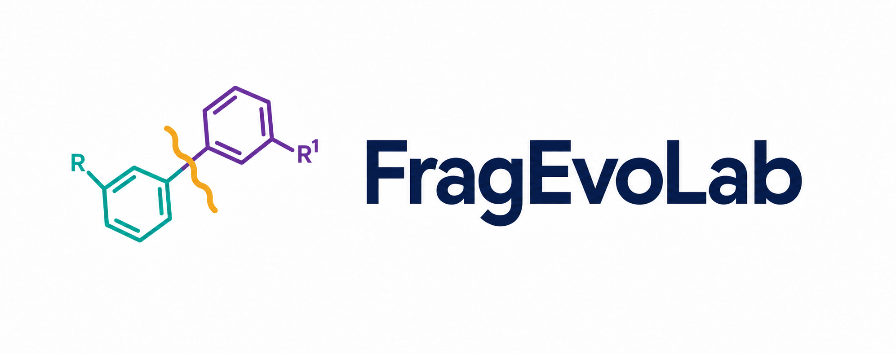

# FragEvoLab 3.1.4

<p align="center">
  
</p>


FragEvoLab generates small molecules through evolutionary search and evaluates them using AutoDock Vina docking. Input structures are supplied as SMILES. The program builds a BRICS fragment bank, modifies molecules through atom-level and fragment-level mutations, assembles new structures, and selects candidates using a single scalar fitness function.

Features include multiple targets and off-targets, manually specified mutation probabilities, adaptive weights, preparation and docking caches, resumption from a completed generation, HTML reports, and CSV/JSON export.

This is a pre-release research build. The Vina score is a computational search criterion, not a measured activity, Ki, or demonstration of selectivity. The program does not prepare receptors, remove bound ligands from receptors, or model metabolism. Users must supply prepared receptors and appropriate docking boxes.

The package includes source code, automated tests, and verification scripts. A runnable technical example with 40 ligands, prepared JAK1/JAK2 receptors and box configurations is included in [data](data/README.md). Before a calculation, install the dependencies and Vina, supply your data, and configure evolution. The supplied `evolution_settings.json` selects `JAK1_3EYG` as the target and `JAK2_6BBV` as the off-target. The matching inputs are already in `data/`. To use other receptors, replace these names and supply matching receptor and box files.

## 1. Requirements

- Python 3.12 and a dedicated virtual environment.
- Python dependencies listed in `requirements.txt`.
- A separate AutoDock Vina executable for your operating system. The example uses the Vina scoring function and is compatible with AutoDock Vina 1.2.7.
- Receptors in PDBQT format, docking box configurations, and an input molecule table.
- Write access to the project directory.

VS Code provides an editor and terminal; it does not install Python or Vina. Run the commands below from the extracted project root containing `main.py`. Do not copy `.venv` between computers: recreate the environment.

## 2. Windows installation using VS Code

1. Install Python 3.12 for Windows. Enable the options to add Python to PATH and install Python Launcher, if available.
2. Extract the project, for example to `C:\FragEvoLab`.
3. In VS Code, select File -> Open Folder and open the directory containing `main.py`.
4. Select Terminal -> New Terminal. The following commands use PowerShell.

Check Python and create the environment:

```powershell
py -3.12 --version
py -3.12 -m venv .venv
.\.venv\Scripts\python.exe -m pip install --upgrade pip
.\.venv\Scripts\python.exe -m pip install -r requirements.txt
```

If `py` is unavailable, try `python --version`. If it reports Python 3.12, use `python` instead of `py -3.12`. If neither command is recognized, install Python or fix PATH, then fully restart VS Code. Do not proceed if environment creation or dependency installation fails.

These commands specify the environment's Python executable explicitly, so activation is unnecessary. You do not need to change the PowerShell execution policy for `Activate.ps1`. In VS Code, use Python: Select Interpreter to select `.venv\Scripts\python.exe`.

Create a `tools` directory and place `vina.exe` there. You can copy a working Windows Vina executable from an earlier installation. A Linux executable cannot be used on Windows.

```powershell
.\tools\vina.exe --version
```

Set `app_settings.json` to:

```json
{
  "vina_executable": "tools/vina.exe"
}
```

Forward slashes are convenient in JSON, including on Windows. Backslashes must be escaped: `C:\\Tools\\vina.exe`. A relative Vina path is resolved against the project root. The value `"vina"` searches PATH.

## 3. Linux installation

Use Python 3.12 with the `venv` module available:

```bash
python3.12 --version
python3.12 -m venv .venv
./.venv/bin/python -m pip install --upgrade pip
./.venv/bin/python -m pip install -r requirements.txt
```

Place the Linux Vina executable at `tools/vina`:

```bash
chmod +x tools/vina
./tools/vina --version
```

Set `app_settings.json` to `{"vina_executable": "tools/vina"}`. If Python or `venv` is missing, install it using your system's package management tools first. For the Windows commands below, substitute `./.venv/bin/python` for `.\.venv\Scripts\python.exe` and use `/` in paths when running on Linux.

## 4. File layout

| Path | Purpose |
| --- | --- |
| `main.py` | Menu and preflight check entry point |
| `requirements.txt` | Runtime dependencies |
| `app_settings.json` | Vina executable path |
| `cpu_settings.json` | Vina thread budget |
| `evolution_settings.json` | Evolution settings used by the menu |
| `data/ligands.csv` | Default input molecule table |
| `data/proteins/NAME.pdbqt` | Prepared receptor |
| `data/configs/NAME.txt` | Docking box and additional Vina settings for this receptor |
| `assets/` | Branding logo |
| `src/core/` | Cache, settings, CPU allocation, preflight checks, and utilities |
| `src/preparation/` | SMILES input and ligand preparation |
| `src/docking/` | Vina execution and result processing |
| `src/evolution/` | Generation, selection, fragments, mutations, and checkpoints |
| `src/reporting/` | Report generation |
| `src/ui/` | Menus and progress indicators |
| `output/` | Generated results |
| `.calculation_cache/` | Generated calculation cache |

Starting the program requires the source code and dependencies. Calculations additionally require Vina and input data. If your copy does not contain `data/`, create it with `proteins` and `configs` subdirectories.

## 5. Exact molecule table format

The default filename is `ligands.csv` (plural), with the full path `data/ligands.csv`. A file named `ligand.csv` is not selected automatically. For evolution, another CSV can be selected in the menu or supplied with `--seeds`.

Example:

```csv
name,smiles
ethylamine,CCN
phenethylamine,NCCc1ccccc1
benzylamine,NCc1ccccc1
N_methylbenzylamine,CNCc1ccccc1
```

Parser requirements:

- Use a text CSV file encoded as UTF-8, with or without a BOM. `.xlsx` is not supported; export CSV UTF-8 from Excel.
- The first row must contain headers. The `smiles` column is required and case-sensitive. `SMILES` and `Smiles` are not substitutes.
- For names, use one column: `name` **or** the legacy header `название`. Do not include both.
- Names are optional. If there is no name column, the program generates `ligand_000001`, `ligand_000002`, etc. If the column exists but cells are empty, names are not filled automatically; supply them.
- The delimiter is detected from comma, semicolon, and tab. Use one delimiter consistently throughout the file.
- Quote fields containing the delimiter, for example `"compound, variant A"`.
- Duplicate headers and rows with extra fields cause an error. Additional named columns are allowed but do not affect evolution: measured Ki, activity labels, and user scores in the CSV are not used as fitness.
- Nonempty, unique names and nonempty SMILES are recommended. Some preparation operations exclude ambiguous names.

Minimal accepted file:

```csv
smiles
CCN
NCCc1ccccc1
```

Evolution identifies molecules by their canonical structures, not row names. Invalid structures and molecules that violate the constraints are excluded; duplicate canonical structures are counted once. A run is blocked if no suitable molecules remain. If there are more than `population_size`, a reproducible random subset is selected using `seed`; otherwise, G0 remains smaller than the requested population size.

Evolution requires complete molecules: not salts with disconnected components, BRICS fragments containing `*`, or radicals. Users are responsible for protonation, tautomer selection, and stereochemistry. Generating 3D coordinates does not replace this standardization. The program derives BRICS fragments from input molecules; there is no separate fragment CSV input.

## 6. Receptors and docking box configurations

Each selected receptor requires two files with the same base name:

- `data/proteins/protein_name.pdbqt`
- `data/configs/protein_name.txt`

Use `"protein_name"` in evolution settings, without the path or extension. Preserve case exactly: Linux filenames are case-sensitive. Configuration extensions `.conf` and `.config` are also supported; `.txt` takes priority when several exist. Keep one configuration per receptor.

Example syntax:

```text
center_x = 10.0
center_y = 20.0
center_z = 30.0
size_x = 22.0
size_y = 22.0
size_z = 22.0
num_modes = 9
energy_range = 3.0
scoring = vina
```

The center uses the receptor's coordinate system; dimensions are in angstroms and must be strictly positive. Select them for the intended binding site. Preflight checks validate the presence and format of parameters, not the choice of binding site or receptor preparation.

Supported additional keys: `num_modes`, `energy_range`, `min_rmsd`, `spacing`, `max_evals`, `verbosity`, `scoring`, `seed`, `cpu`, and `exhaustiveness`. `scoring` accepts `vina` or `vinardo`. Comments after `#` are allowed. Unknown or duplicate keys block the calculation. This interface does not support flexible receptors, external maps, or arbitrary command-line arguments.

Setting precedence:

- The program selects the receptor; a `receptor` entry in the configuration is ignored.
- `exhaustiveness` from the menu or evolution JSON overrides the box configuration value.
- If the box configuration specifies `seed`, it takes priority; otherwise the calling module's seed is used. Avoid duplicating `seed` in box configurations if you want centralized control through evolution settings.
- The configuration's `cpu` value is limited by the application budget. A CPU value of 0 is not allowed.

## 7. CPU budget and parallel jobs

Example `cpu_settings.json`:

```json
{
  "cpu_budget": 4,
  "cpu_per_job": 1
}
```

`cpu_budget` limits the total allocated Vina threads within one application process for the project. `cpu_per_job` is the maximum thread count per docking job. `num_workers` in the evolution JSON requests a number of parallel jobs; it does not override the budget.

For example, a budget of 4, one thread per job, and `num_workers=8` does not allow eight one-thread jobs to occupy eight threads concurrently. Settings are capped by the available logical CPUs. This limits Vina jobs; it is not an operating-system limit on total computer utilization. Independent application instances do not share a cross-process budget, so allocate resources manually between them.

Settings can be changed using main menu item 25 before a calculation. Restart the application after editing the JSON manually.

## 8. Configuring evolution in JSON

The menu reads `evolution_settings.json` from the project root. Edit it directly or import another file using evolution menu item 2. Importing saves the settings to `evolution_settings.json`. The command-line interface uses the file specified by `--config`; renaming is unnecessary.

JSON requires double quotes, a decimal point, `true`/`false` for Boolean values, and `null` for an absent value. Comments and trailing commas before `}` or `]` are not allowed. Unknown parameters cause an error. Omitted optional parameters receive the defaults listed below.

Complete example for a short JAK1-versus-JAK2 technical check:

```json
{
  "targets": [
    {"name": "JAK1_3EYG", "weight": 1.0, "threshold": null, "offset": 0.0, "scale": 1.0}
  ],
  "off_targets": [
    {"name": "JAK2_6BBV", "weight": 1.0, "threshold": -5.0, "offset": 0.0, "scale": 1.0}
  ],
  "penalty_strength": 1.0,
  "target_aggregation": "mean",
  "population_size": 6,
  "generations": 1,
  "parent_count": 4,
  "elite_fraction": 0.34,
  "mutation_fraction": 0.75,
  "level_probabilities": {"atom": 0.4, "fragment": 0.6},
  "atom_probabilities": {"add_atom": 0.3, "remove_atom": 0.2, "substitute_atom": 0.3, "change_bond": 0.2},
  "mutation_steps": 1,
  "adaptive_fragments": true,
  "adaptive_operators": false,
  "exploration": 0.2,
  "prior_strength": 5.0,
  "reward_scale": 1.0,
  "min_operator_observations": 5,
  "max_attempts_per_slot": 12,
  "max_similarity": 1.0,
  "max_mw": 650.0,
  "max_logp": 7.0,
  "min_nitrogen": 0,
  "seed": 42,
  "preparation_seed": 42,
  "exhaustiveness": 1,
  "num_workers": 4,
  "force_preparation": false,
  "force_docking": false
}
```

The threshold of -5.0 and other numbers illustrate configuration; they are not validated selectivity criteria. `exhaustiveness=1`, one generation, and a small population are intended for a technical check. A separate study protocol must define settings for a full investigation.

### 8.1. Multiple targets and off-targets

The two lists in the example can be replaced with:

```json
{
  "targets": [
    {"name": "TARGET_A", "weight": 2.0, "threshold": -7.0},
    {"name": "TARGET_B", "weight": 1.0, "threshold": null}
  ],
  "off_targets": [
    {"name": "OFF_A", "weight": 1.0, "threshold": -5.0},
    {"name": "OFF_B", "weight": 0.5, "threshold": -6.0}
  ]
}
```

This is also a valid standalone minimal JSON configuration, but all other parameters will use their defaults. Replace the placeholders with your file base names.

At least one target is required. Lists must not contain duplicates or overlap. Targets support the shorthand `"targets": ["protein_name"]`; each off-target requires an object with an explicit `threshold`. Set `"off_targets": []` to disable negative selection.

| Receptor field | Default | Meaning |
| --- | --- | --- |
| `name` | Required | Base name of the receptor and configuration files |
| `weight` | 1.0 | Nonnegative weight; the sum of target weights must be positive |
| `threshold` | null | Target: hard score threshold E <= threshold. Off-target: required threshold at which a penalty begins |
| `offset` | 0.0 | Score offset used only for target utility; the current off-target formula does not use it |
| `scale` | 1.0 | Positive scaling factor for target utility or off-target penalty |

### 8.2. Fitness calculation

Each molecule requires successful docking against every listed receptor, including receptors with zero weight. Candidates with incomplete results are ineligible for selection.

For a target with docking score E, utility is `u = -(E - offset) / scale`.

- `target_aggregation="mean"`: weighted mean of u over targets with positive weights.
- `target_aggregation="worst"`: minimum u over targets with positive weights. The magnitudes of positive weights do not affect this minimum.
- If a target has a `threshold`, the molecule must satisfy `E <= threshold` for that target. This is a separate feasibility condition, not an additional penalty. It applies even when the target weight is zero.

For each off-target, `p = weight * max(0, (threshold - E) / scale)`. The total penalty P is the maximum p over off-targets; P = 0 if the list is empty.

The final score is `fitness = target_utility - penalty_strength * P`. Higher fitness ranks a candidate higher in selection. An off-target score above the threshold incurs no penalty; further weakening of predicted binding does not provide an unlimited bonus.

Example with unit weights and scales, zero offsets, and an off-target threshold of -5:

| Candidate | Target E | Off-target E | Utility | Penalty | Fitness at penalty_strength=1 |
| --- | --- | --- | --- | --- | --- |
| A | -8 | -7 | 8 | 2 | 6 |
| B | -7.5 | -5 | 7.5 | 0 | 7.5 |

B ranks higher. This is a numerical trade-off between docking scores, not an experimental comparison of activities. Scores from different receptors are not automatically comparable; the program does not learn offset/scale values, which require independent justification.

### 8.3. Population and selection settings

The tables list code defaults, which may differ from the supplied `evolution_settings.json` and the example above.

| Parameter | Default | Purpose and limits |
| --- | --- | --- |
| `penalty_strength` | 1.0 | Off-target penalty multiplier, >= 0 |
| `target_aggregation` | `mean` | `mean` or `worst` |
| `population_size` | 50 | Requested generation size, integer >= 1 |
| `generations` | 5 | Number of generations after G0, integer >= 0; 0 evaluates only input molecules |
| `parent_count` | 10 | Maximum selected parents and maximum final top_molecules list size, integer >= 1 |
| `elite_fraction` | 0.1 | Fraction of population slots reserved for elites, >= 0 and < 1 |
| `mutation_fraction` | 0.65 | Fraction of non-elite slots assigned to mutation; the rest use fragment assembly, from 0 to 1 |
| `max_attempts_per_slot` | 30 | Maximum attempts to fill one slot with a new candidate, integer >= 1 |
| `max_similarity` | 1.0 | Upper pairwise Tanimoto similarity threshold using Morgan fingerprints (radius=2, 2048 bits) during selection and offspring acceptance, from 0 to 1 |

The elite count is at most `floor(population_size * elite_fraction)` and cannot exceed the number of available parents. Mutation slots are rounded using `int(remaining_slots * mutation_fraction + 0.5)`. A mutation parent is sampled randomly from the selected parents.

New structures must not duplicate previously explored canonical SMILES. `max_similarity=1` disables the additional similarity constraint, but not duplicate checks. Offspring similarity is compared with molecules already accepted into the current generation, not the entire historical archive. A slot may remain empty after exhausting attempts; the requested generation size is not guaranteed.

### 8.4. Mutations and adaptation

| Parameter | Default | Purpose |
| --- | --- | --- |
| `level_probabilities` | atom=0.4, fragment=0.6 | Probabilities of atom-level mutation and fragment replacement |
| `atom_probabilities` | add_atom=0.3, remove_atom=0.2, substitute_atom=0.3, change_bond=0.2 | Conditional operator probabilities after selecting atom-level mutation |
| `mutation_steps` | 1 | Sequential modifications per offspring, integer >= 1 |
| `adaptive_fragments` | true | Update fragment weights using replacement outcomes |
| `adaptive_operators` | false | Adapt level/operator probabilities using accumulated rewards |
| `exploration` | 0.2 | Exploration component fraction, from 0 to 1 |
| `prior_strength` | 5.0 | Positive smoothing strength for estimates with few observations |
| `reward_scale` | 1.0 | Positive fitness-difference scale in the reward tanh(delta / reward_scale) |
| `min_operator_observations` | 5 | Minimum evaluated comparisons before adapting an operator, integer >= 1 |

Both probability dictionaries must contain every specified key, contain only nonnegative numbers, and each sum to 1. Zero probability disables the corresponding choice; adaptation does not re-enable it.

For fragment-only mutations:

```json
{"atom": 0.0, "fragment": 1.0}
```

This is the value of `level_probabilities`, not a complete configuration. Set `adaptive_operators=false` to retain fixed manual probabilities. You may keep `adaptive_fragments=true`: individual fragment selection will remain adaptive while the fragment-level probability stays fixed.

With atom=0.4 and add_atom=0.3, the probability of selecting add_atom on one mutation step is 0.12. This is an attempt probability, not a guaranteed proportion of successful products: operations may be inapplicable or rejected. With `mutation_steps>1`, each step selects its level and operator independently.

Atom-level operators are `add_atom`, `remove_atom`, `substitute_atom`, and `change_bond`. Eligible sites and changes are first enumerated using valence rules; RDKit validation follows the edit. Fragment operations use BRICS attachment-point compatibility. These checks reduce invalid structures but do not guarantee synthetic accessibility or chemical stability.

The fragment bank stores provenance, attempt statistics, product validity, duplicates, scores, and changes in docking scores. Associations between a fragment and the scores of molecules containing it are stored separately from parent-offspring comparisons. Weight rewards are assigned for single fragment replacements; the full effect of a multistep chain is not attributed to every fragment in that chain. Consequently, many fragment weights may remain 1 even after several generations.

For fragments, exploration mixes the adaptive distribution with a uniform distribution; for operators, it mixes with the original manual probabilities. `min_operator_observations` applies to operators, not fragment weights. A multistep mutation receives a chain-level reward without separately updating each individual operator.

### 8.5. Molecular constraints

| Parameter | Default | Purpose |
| --- | --- | --- |
| `max_mw` | 500.0 | Maximum RDKit MolWt, >= 0 |
| `max_logp` | 5.0 | Maximum predicted RDKit MolLogP, finite number |
| `min_nitrogen` | 1 | Minimum nitrogen atom count, integer >= 0 |

Constraints also apply to input molecules and elites. If nitrogen is not required, explicitly set `min_nitrogen=0`; otherwise, the default excludes all nitrogen-free structures. These three parameters are not a comprehensive drug-likeness, ADMET, or synthetic accessibility filter.

### 8.6. Docking and reproducibility

| Parameter | Default | Purpose |
| --- | --- | --- |
| `seed` | 42 | Positive integer for evolution and Vina, unless the box configuration overrides it |
| `preparation_seed` | 42 | Nonnegative integer for conformer generation |
| `exhaustiveness` | 4 | Vina search effort, integer >= 1 |
| `num_workers` | 3 | Requested parallel job count, integer >= 1 |
| `force_preparation` | false | Force ligand preparation to run again |
| `force_docking` | false | Force docking to run again |

Leave both `force_*` options false for normal runs. A nonzero seed supports reproducibility in an unchanged environment, but does not guarantee bitwise identity across operating systems, library versions, or Vina versions.

## 9. First run using the menu

1. Populate `data/ligands.csv` and add receptors with their configurations.
2. Set the Vina path in `app_settings.json`, CPU settings in `cpu_settings.json`, and evolution settings in `evolution_settings.json`.
3. Run the preflight check:

```powershell
.\.venv\Scripts\python.exe main.py --check --config evolution_settings.json --seeds data/ligands.csv
```

The check does not run 3D preparation, docking, or evolution. It may create service directories/cache files and checks write access. Passing does not guarantee convergence of every ligand preparation or successful Vina execution. Exit code 0 means that the checked conditions passed; 1 indicates errors.

4. Start the menu:

```powershell
.\.venv\Scripts\python.exe main.py
```

5. Enter `21` in the main menu for evolutionary generation.
6. If needed, select `2` and supply a JSON file to import. Item `1` edits individual parameters: enter the field number and then a JSON value; `0` validates and saves the configuration. Quote string values, for example `"worst"`, and enter dictionaries in full.
7. Item `6` checks readiness using the saved settings and default CSV. For another CSV, use the check command with `--seeds` or the check performed when starting a new run.
8. Select `3` for a new calculation. At the CSV prompt, press Enter for `data/ligands.csv` or enter your path.
9. Review the summary and enter `yes` to start.
10. Wait for results to be saved. The terminal displays the HTML, JSON, and checkpoint paths.

The main menu also provides preflight checks through item `26`. Do not change inputs, settings, or source files during a calculation. Keep the computer on; locking the screen is acceptable, but sleep suspends execution.

## 10. Running without the menu

Start a new calculation:

```powershell
.\.venv\Scripts\python.exe -m src.evolution.cli --project . --config evolution_settings.json --seeds data/ligands.csv
```

Optionally specify Vina and CPU allocation explicitly:

```powershell
.\.venv\Scripts\python.exe -m src.evolution.cli --project . --config evolution_settings.json --seeds data/ligands.csv --vina tools/vina.exe --cpu-budget 4 --cpu 1 --timeout 3600
```

`--cpu` is the maximum number of Vina threads per job; `--cpu-budget` is the overall budget for this process/project. `--timeout` is the timeout in seconds for each docking process, defaulting to 3600. The CLI starts the calculation after a successful preflight check without interactive confirmation.

Supply relative CLI paths for config, seeds, and checkpoint relative to the current working directory; use absolute paths when launching elsewhere. `--project` does not itself change Python's working directory.

## 11. Generations, stopping, and resuming

G0 contains the selected input molecules. G1 and later contain elites, mutants, and assembly products. `generations=5` means G0 plus five subsequent generations, unless the search stops earlier.

Report stop reasons:

| `stop_reason` | Meaning |
| --- | --- |
| `generation_limit` | Requested generation limit reached |
| `no_feasible_candidates` | No feasible candidates with complete docking results and satisfied target thresholds |
| `no_valid_offspring` | Unable to create a nonempty next generation |
| `search_exhausted` | No new candidates in the generation |
| `paused` | Technical pause requested through the API after a specified generation |

A checkpoint is saved after completing a generation, not after each candidate. Use Ctrl+C to stop. If interrupted within a generation, resumption starts from the last saved generation. Compatible completed calculations may be reused from cache. No checkpoint exists before G0 is saved for the first time.

Resume through the menu: `21` -> `4` -> path to `checkpoint.json` -> check -> confirmation.

For the CLI, replace RUN_ID with an actual result directory name:

```powershell
.\.venv\Scripts\python.exe -m src.evolution.cli --project . --config evolution_settings.json --resume output/evolutionary/RUN_ID/checkpoint.json
```

Resumption requires matching parameters, receptors and configurations, the Vina executable, tracked source files, CPU settings, timeout, and computational environment. You may change `generations`, including increasing it, but it cannot be lower than the saved generation. Changing weights, mutation probabilities, or constraints requires a new run. Checkpoints are generally incompatible across operating systems or program versions. Do not edit the fingerprint to bypass this check.

**Checkpoint compatibility:** source contents contribute to fingerprints. Source changes can invalidate checkpoints even when numerical algorithms are unchanged. Resume with the same implementation or start a new run.

To check resumption readiness:

```powershell
.\.venv\Scripts\python.exe main.py --check --config evolution_settings.json --resume output/evolutionary/RUN_ID/checkpoint.json
```

## 12. Result locations

Each new evolutionary run receives its own `output/evolutionary/RUN_ID/` directory:

| File | Contents |
| --- | --- |
| `report.html` | Visual report on generations, candidates, and fragments; open in a browser |
| `report.json` | Settings, docking scores, fitness, history, mutation events, and fragment/operator statistics |
| `candidates.csv` | All archived candidates: smiles, generation, origin, parent, fitness, feasible, and receptor-specific docking scores |
| `checkpoint.json` | Resumption state: RNG, archive, population, fragment bank, and statistics |

Key fields:

- Candidate `generation` is its generation of origin; elites retain it when carried into later generations.
- `origin`: seed, mutation, or assembly.
- `parent`: parent SMILES for a mutant; may be absent for assembly products and input molecules.
- `fitness`: final score to maximize; it is not the docking score.
- `feasible`: feasibility conditions are satisfied. Selection also requires complete docking scores (`complete` in JSON).
- `top_molecules`: best feasible candidates across the archive, subject to parent_count and max_similarity.
- `used_level_probabilities` and `used_atom_probabilities`: probabilities actually used for the generation.
- `total_dockings`: number of molecule-receptor pairs actually calculated, not the number of molecules.

Docked poses are stored separately in `output/docking_results/by_id/`; docking results contain artifact paths. Input PDBQT files are copied to `output/inputs/`. When sharing results, include related files, not just a report image.

## 13. Reweighting scores without new docking

Copy the configuration to `rescoring_settings.json` and change weights, thresholds, or penalty_strength. Use evolution menu item `5`, or run:

```powershell
.\.venv\Scripts\python.exe -m src.evolution.reweight --checkpoint output/evolutionary/RUN_ID/checkpoint.json --config rescoring_settings.json --output rescored.json
```

This creates a separate JSON file with updated scores for previously evaluated candidates. Do not overwrite the original checkpoint. If you add a receptor whose scores are absent from the checkpoint, candidates become incomplete; this command does not perform missing docking calculations. The reweighted report is not a new checkpoint and does not change historical adaptive rewards or the completed evolutionary trajectory.

## 14. Docking without evolution

Select main menu item `4`:

1. Select receptors by numbers separated by spaces or commas, or enter `all`.
2. Select molecules from `data/ligands.csv` the same way, or enter `write smiles`.
3. For manual entry, enter one SMILES per line; an empty line finishes input and `0` cancels. The original CSV is unchanged.
4. Specify exhaustiveness and the number of jobs, then answer the overwrite prompt.
5. Review the summary and confirm the run.
6. Generate reports after completion if desired.

Ranges such as `1-5` are not supported; enter `1 2 3 4 5`. Negative selection and mutations belong to evolutionary mode and are not automatically applied to ordinary docking.

Docking batch results are saved to `output/runs/docking-.../results.json`; `output/cache/docking_results.json` holds a view of the most recent batch.

## 15. Cache and ligand preparation

Preparation uses RDKit + Meeko: ETKDGv3 3D embedding, UFF optimization, and PDBQT output. If UFF does not converge on the first attempt, the code performs additional attempts. Preparation fails if the limit is exhausted. An initial nonconvergence message does not necessarily indicate final failure; check the final status for that ligand.

The cache distinguishes input structures and preparation/docking parameters, not just filenames. Changes to receptor contents or relevant parameters must not reuse an incompatible previous result. Preflight checks do not establish the physical validity of inputs.

Do not delete the cache during a calculation. Cleaning it after completion does not remove the input CSV, but may require recalculation. Deleting `output/` destroys reports, checkpoints, and saved artifacts; back up results before cleanup.

## Tests in the full working build

Install test dependencies and run:

```powershell
.\.venv\Scripts\python.exe -m pip install -r requirements-test.txt
.\.venv\Scripts\python.exe -m pytest -q
```

The default suite checks chemistry, preparation, caching, settings and reports without executing docking. It requires Python dependencies but no installed Vina. The bundled-data checks also verify the supplied input files. Real docking is an explicit separate command requiring `--vina`, `--data-dir`, and `--config`. Ligand-dataset preparation is a third, optional command that does not require Vina. See [docs/testing.md](docs/testing.md) for commands, prerequisites, exit codes, and limitations.

The bundled [JAK example](data/README.md) supplies inputs for the real integration command. See [data provenance](docs/test_data.md) for sources and limitations.

## Estimated Ki and pKi: temperature and limitations

The standard docking-score-to-Ki/pKi conversion uses **298.15 K (25 °C)**. These are approximate estimates, not experimental Ki values or evidence of activity or selectivity. Vina scores must not be treated as exact Gibbs free energies of binding.

The input docking score is in kcal/mol, Ki is in mol/L (M), and pKi is dimensionless. Temperature applies only to this conversion; it is not a simulation temperature or a separate Vina setting. Evolutionary selection uses docking scores and fitness, not estimated Ki.

The formula, standard state, and limitations are documented in [docs/affinity_estimates.md](docs/affinity_estimates.md). HTML reports include an explanatory note; docking CSV reports have an accompanying `<report>.csv.notes.txt` file. Include it when sharing the table. Numeric columns are unchanged; the English build writes `name` instead of the legacy Russian name header. Evolutionary candidate CSV files do not include Ki/pKi.

The API still allows an explicit alternative temperature. For imported results or results from custom API calls, 298.15 K cannot be assumed to be the actual conversion temperature; verify it from the data provenance. Previously saved reports are not rewritten automatically.

## License

FragEvoLab's original code is distributed under the [MIT License](LICENSE).
Copyright (c) 2026 Kirill V. Karhanin.

Third-party packages, external executables, and datasets retain their own
licenses and terms; the project's MIT license does not replace those terms.
See [licensing and distribution](docs/licensing.md) for LGPL, GPL and native-runtime conditions.
See [THIRD_PARTY_NOTICES.md](THIRD_PARTY_NOTICES.md) for dependency licenses,
[docs/references.md](docs/references.md) for scientific citations, and
[docs/test_data.md](docs/test_data.md) for data provenance and limitations.

## Authors and acknowledgments

- **Kirill V. Karhanin** - software author and developer.
- **Alexander S. Novikov** - scientific supervision.

Scientific supervision is acknowledged separately from software authorship.

## Citation and provenance files

| File | Purpose |
|---|---|
| [CITATION.cff](CITATION.cff) | Machine-readable software citation |
| [AUTHORS.md](AUTHORS.md) | Software author and scientific-supervision acknowledgment |
| [docs/references.md](docs/references.md) | Sources for the methods actually used |
| [THIRD_PARTY_NOTICES.md](THIRD_PARTY_NOTICES.md) | Component versions, licenses and redistribution scope |
| [licenses/README.md](licenses/README.md) | Retained upstream license-text snapshots |
| [docs/test_data.md](docs/test_data.md) | JAK1/JAK2 and ligand provenance, curation and known limitations |
| [data/ligand_sources.csv](data/ligand_sources.csv) | Per-ligand PubChem identifiers and record links |

## Candidate failures and result export

All configured target and off-target scores are required. If preparation or any required docking fails, the candidate is rejected and cannot enter selection. Partial scores are not stored in its checkpoint and cannot be recovered by offline reweighting. Successful individual calculations may remain in the calculation cache and diagnostic generation JSON. There is no automatic retry loop for a rejected candidate.

Export results after calculations finish. The export includes run metadata, immutable input/prepared files and a consistent SQLite snapshot. Its manifest maps original paths to archive paths and records SHA-256 hashes and optional exclusions. This is a result collection, not a runnable installation or cache backup.
